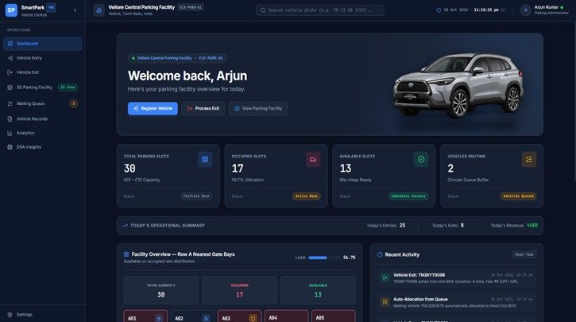
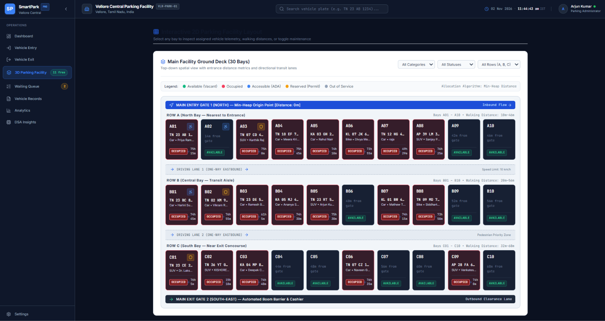
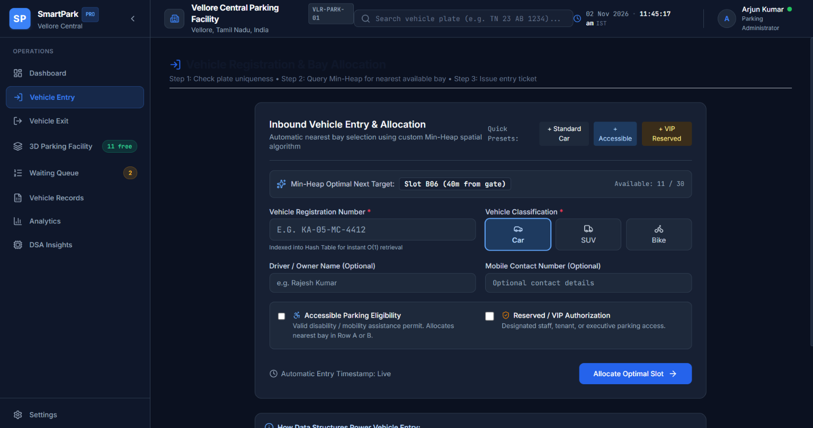
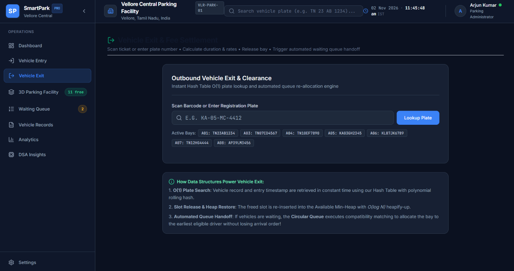
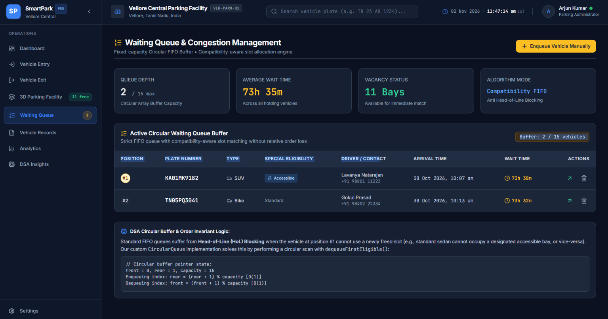
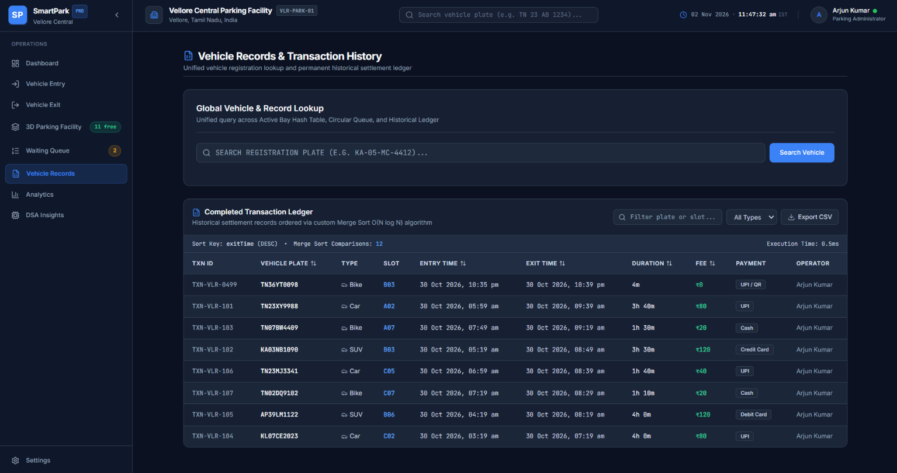
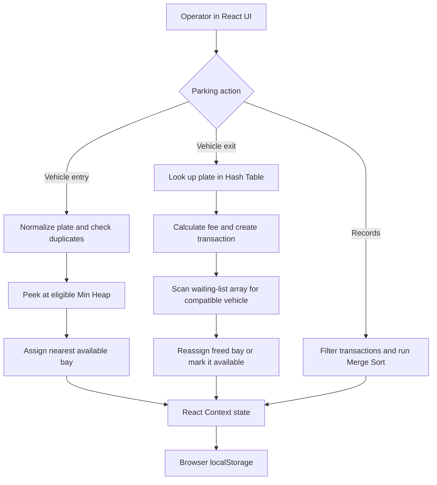
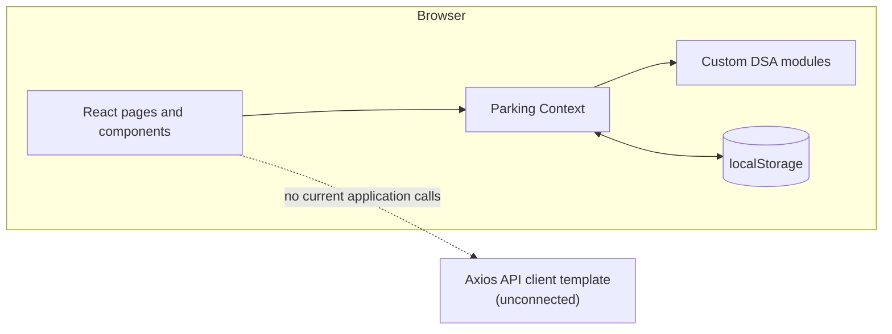

# SmartPark

**[Live Demo](https://smartpark-parking-management.vercel.app/)**

### Smart parking operations, powered by classic data structures.

[](https://react.dev/)
[](https://developer.mozilla.org/docs/Web/JavaScript)
[](https://vite.dev/)
[](https://tailwindcss.com/)
[](https://reactrouter.com/)
> A front-end parking operations demo that connects slot allocation, vehicle lookup, transaction sorting, and waiting-list workflows to custom JavaScript data structures.

## Dashboard



*The dashboard summarizes facility occupancy, available bays, queued vehicles, and recent activity.*

## Project overview

SmartPark models common parking-facility tasks in an interactive single-page application. Operators can review a 2D bay layout, register vehicle arrivals, look up exits and calculate fees, manage a waiting list, and inspect transaction records. The project is also a practical study of how heaps, hash tables, queues, and merge sort can support those workflows.

This repository contains a **client-side demonstration**, not a production parking service. Application state is kept in the browser with React and `localStorage`; there is no connected backend, database, authentication, payment processing, or cloud persistence.

## Application showcase

| Screen | Preview |
|---|---|
| **Parking Facility** |  |
| **Vehicle Entry** |  |
| **Vehicle Exit** |  |
| **Waiting Queue** |  |
| **Vehicle Records** |  |

## Key features

- Dashboard with occupancy summaries, quick actions, a slot preview, and recent-activity cards.
- Vehicle entry with registration checks, vehicle categories, accessible/reserved eligibility, and nearest-slot suggestions.
- Vehicle exit with active-vehicle lookup, duration-based fee calculation, transaction creation, and a freed-bay queue handoff.
- Interactive 2D facility layout with bay status inspection and maintenance controls.
- Waiting-list view with capacity, add/cancel actions, wait-time summaries, and manual admission.
- Vehicle and transaction lookup, filters, sortable history, and CSV export.
- Analytics and DSA insights, including hash-table statistics and selected operation measurements.
- Browser `localStorage` persistence for slots, queue contents, transactions, and settings; default records seed a new browser profile, while existing browser data takes precedence.

## Technology

| Area | Tools |
|---|---|
| UI | React 19, React Router 7 |
| Language | JavaScript (ES modules and JSX) |
| Styling | Tailwind CSS 3, custom CSS |
| Build | Vite 8 |
| Charts and icons | Recharts, Lucide React |
| Client state | React Context, browser `localStorage` |
| API client | Axios template in `src/services/api.js` (not connected to the application workflow) |

## Data structures and integration audit

The project includes custom implementations in `src/dsa/`. Their presence in the codebase does not mean every class powers the corresponding screen: the active integration is described explicitly below.

| Structure | Core operation complexity | Current application integration |
|---|---|---|
| **Min Heap** | `peekMin`: `O(1)`; `insertSlot` / `extractMin`: `O(log A)`; `buildHeap`: `O(A)` | When slot state changes, the context rebuilds heaps for available bays using repeated insertions (`O(A log A)` per heap). Entry selects the nearest eligible bay with `peekMin()`. Allocation does **not** call `extractMin()`; slot state changes trigger a later heap rebuild. |
| **Circular Queue** | `enqueue` / `dequeue` / `peek`: `O(1)`; `dequeueFirstEligible`: `O(K)` time and `O(K)` extra space | The class implements a fixed-capacity circular buffer and compatibility-aware removal. The context constructs and exposes a synchronized instance, but the primary add, cancel, and exit-handoff flows operate on the React array state instead. Automatic handoff scans that array for a compatible vehicle. |
| **Hash Table** | Hash computation: `O(L)`; lookup/insert/delete: average `O(1)` and worst `O(N)` with separate chaining | A table is rebuilt from occupied bays when slot state changes. It supports duplicate-registration checks and vehicle lookup during exit. Average bounds assume a reasonable key distribution and bounded chain lengths. |
| **Merge Sort** | `O(T log T)` time; `O(T)` auxiliary space | The transaction table filters records first, then uses the stable custom merge sort for its selected sort key. The implementation returns comparison counts and an elapsed-time measurement. |

`A` is the number of available bays, `K` is the current queue length/capacity, `N` is the number of indexed vehicles, `T` is the number of filtered transactions, and `L` is the registration-key length.

### DSA measurement notes

- Hash-table lookup and Merge Sort expose measurements from the current in-memory data. These timings are browser observations, not production benchmarks.
- The DSA panel's heap operation count is estimated from heap height; it does not instrument the active allocation path.
- The queue comparison is explanatory. It does not benchmark the custom `CircularQueue` against the application's array-based queue workflow.
- The `CircularQueue.dequeueFirstEligible()` method is implemented but is not used for automatic exit handoff.

## System workflow



## Architecture



The app is organized around pages and reusable components, with `ParkingContext` coordinating client-side state and operations. The Axios service is a template only; the application does not currently call a server.

## Complexity reference

The table gives algorithmic bounds for the implemented operations, not claims about measured production performance.

| Operation | Time | Auxiliary space | Notes |
|---|---:|---:|---|
| Min Heap `peekMin` | `O(1)` | `O(1)` | Reads the nearest item at the root. |
| Min Heap `insertSlot` / `extractMin` | `O(log A)` | `O(1)` per operation | The heap stores `O(A)` items. |
| Min Heap `buildHeap` | `O(A)` | `O(A)` total storage | Bottom-up heap construction; the context currently rebuilds via repeated insertions instead. |
| Rebuild available-slot heaps in context | `O(A log A)` | `O(A)` per heap | Repeats `insertSlot` for available bays when slot state changes. |
| Circular Queue `enqueue` / `dequeue` / `peek` | `O(1)` | `O(1)` per operation | Fixed-capacity buffer uses `O(K)` storage. |
| Circular Queue `dequeueFirstEligible` | `O(K)` | `O(K)` | Scans for the first eligible item and reconstructs the remaining buffer. |
| Hash-table lookup / insert / delete | Average `O(1)`, worst `O(N)` | `O(N)` | Hashing the key adds `O(L)` work; separate chaining handles collisions. |
| Merge Sort | `O(T log T)` | `O(T)` | Stable sort used on the filtered transaction list. |
| Active array-based queue scan | `O(K)` | `O(K)` for filtered copy | Used by the current exit handoff to find and remove a compatible waiting vehicle. |

## Getting started

### Prerequisites

- Node.js `^20.19.0` or `>=22.12.0` (Vite 8 requirement)
- npm

### Install and run

```bash
git clone https://github.com/Rithigha27-nx/smartpark-parking-management.git
cd smartpark-parking-management
npm ci
npm run dev
```

Open the local address printed by Vite. To create and preview a production build:

```bash
npm run build
npm run preview
```

Run the configured linter with:

```bash
npm run lint
```

There is currently no automated test script in `package.json`.

## Limitations

- Client-side demo only: no backend, database, authentication, authorization, payment processing, or cloud synchronization.
- State is stored in this browser's `localStorage`; it is not shared across users or devices.
- The Axios API client is not connected to the application workflow.
- Queue screens and operations use React array state; the custom circular queue class is not the active queue implementation.
- Some analytics use fixed fallbacks or estimates rather than a complete persisted event history.
- DSA panel heap counts are estimated, and queue comparisons are descriptive rather than instrumented.
- The 17 parked-vehicle defaults are generated illustrative records with generic driver labels and no contact details. The queue and transaction defaults reproduce reviewed screenshot records; unshown driver and contact fields are omitted. These are frontend reference records, not live facility operations.
- No automated tests are configured yet.

## Future enhancements

- Connect a backend and database, then integrate the API client into application workflows.
- Use the custom `CircularQueue` in queue operations, with tests for capacity, wraparound, cancellation, and compatibility-aware handoff.
- Add unit and component tests for the DSA modules and parking workflows.
- Instrument heap operations directly and label measured values separately from estimates.
- Derive analytics from persisted event history and document each metric's scope.
- Add appropriate authentication, authorization, validation, and privacy controls before any production use.

## Team members

- S. Rithigha Shri
- Shahana S S
- Pavithra M
